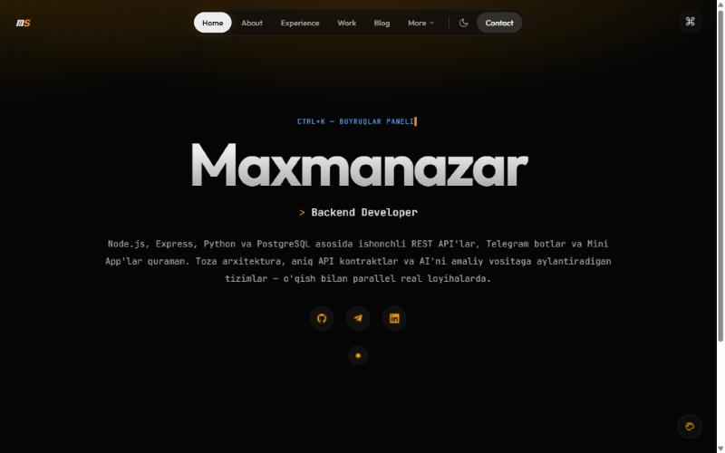
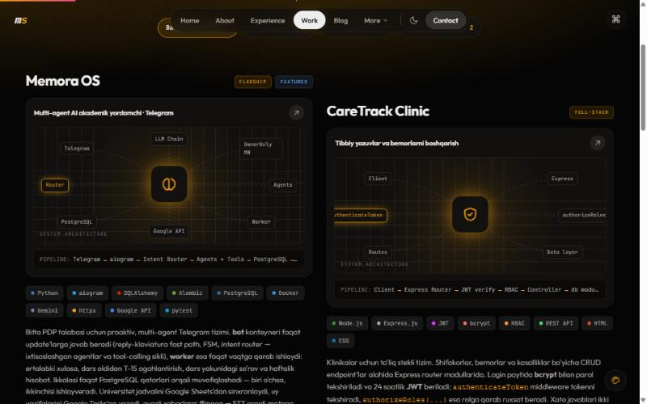
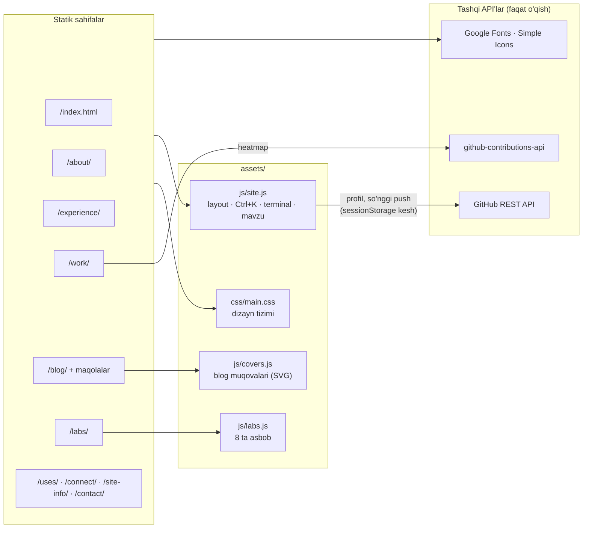

<div align="center">

# ms.dev — Maxmanazar Sultonov

**Backend Developer portfoliosi** · REST API · Telegram botlar · AI integratsiyalar

[](https://maxmanazar025.github.io)
[](https://pages.github.com/)


<br />




**[🌐 Jonli sayt](https://maxmanazar025.github.io)** · **[Loyihalar](https://maxmanazar025.github.io/work/)** · **[Blog](https://maxmanazar025.github.io/blog/)** · **[Labs](https://maxmanazar025.github.io/labs/)** · **[Aloqa](https://maxmanazar025.github.io/contact/)**

</div>

---

## Mundarija

- [Loyiha haqida](#loyiha-haqida)
- [Imkoniyatlar](#imkoniyatlar)
- [Tech stack](#tech-stack)
- [Responsive dizayn](#responsive-dizayn)
- [Arxitektura](#arxitektura)
- [Papka tuzilmasi](#papka-tuzilmasi)
- [Lokal ishga tushirish](#lokal-ishga-tushirish)
- [Deploy](#deploy)
- [Kontentni tahrirlash](#kontentni-tahrirlash)
- [Ishlash, qulaylik va maxfiylik](#ishlash-qulaylik-va-maxfiylik)
- [O'zgarishlar tarixi](#ozgarishlar-tarixi)
- [Muallif](#muallif)

---

## Loyiha haqida

Bu — Toshkentlik Backend Developer, PDP University talabasi **Maxmanazar Sultonov**ning shaxsiy portfoliosi, blogi va interaktiv tajribalar maydonchasi.

Sayt ataylab **framework'siz va build bosqichisiz** qurilgan: faqat statik HTML, CSS va vanilla JavaScript. Natijada u tez yuklanadi, hech qanday bog'liqlik (dependency) talab qilmaydi va istalgan statik hostingda ishlaydi.

## Imkoniyatlar

| | Imkoniyat | Tavsif |
|---|---|---|
| 🧭 | **Ko'p sahifali tuzilma** | 11 ta alohida sahifa: Home, About, Experience, Work, Blog, Labs, Uses, Connect, Site Info, Contact va 404. Bosh sahifada hero'dan keyin raqamlar, tanlangan loyihalar, "Men haqimda" bloki, so'nggi maqolalar va CTA |
| ⌘ | **Buyruqlar paneli (Ctrl + K)** | Guruhlangan qidiruv: sahifalar, loyihalar, maqolalar, havolalar va amallar; o'ng tomonda preview. Telefonda pastdan chiqadigan panel (bottom sheet), pastga surib yopiladi |
| `>_` | **Interaktiv terminal** | `neofetch`, `ls`, `cat about.txt`, `open work` kabi buyruqlar, tarix (↑ ↓) va Tab bilan to'ldirish. Telefonda to'liq ekran va tezkor buyruq tugmalari |
| 🧪 | **Labs** | 8 ta brauzerda ishlaydigan asbob: Token Bucket va Circuit Breaker simulyatsiyalari, JWT Decoder, Base64, UUID, Regex Tester, Chmod Calculator, JSON Formatter |
| 📊 | **Jonli GitHub ma'lumotlari** | Hissalar heatmap'i, streak'lar, so'nggi push va repozitoriylar soni |
| ✍️ | **Blog** | Teg bo'yicha filtr, qidiruv (`/` tugmasi) va real loyihalarga asoslangan maqolalar |
| 🎨 | **Mavzular** | Dark / Light rejim va 5 ta asosiy rang (Amber, Pink, Emerald, Sky, Violet); tanlov saqlanib qoladi |
| 📱 | **Mobil-first responsive** | 320px telefondan 1440px+ monitorgacha 6 ta breakpoint; telefonda pastki tab bar va bottom-sheet menyu, planshetda yon panel (drawer). Batafsil: [Responsive dizayn](#responsive-dizayn) |
| 📸 | **Polaroid galereya** | About sahifasida 3 qavatli rasm to'plami: kompyuterda sichqoncha bilan, telefonda bosish bilan yoyiladi |
| ✨ | **Sahifalar orasida silliq o'tish** | View Transitions API (Chromium) va kartochkalarda sichqonchaga ergashuvchi yorug'lik |
| 🔎 | **SEO va ulashish** | Har sahifada canonical, Open Graph va Twitter Card, 1200×630 OG-rasm, JSON-LD (Person, BlogPosting), `sitemap.xml`, `robots.txt`, web manifest |

## Tech stack

| Qatlam | Texnologiya | Izoh |
|---|---|---|
| Markup | **HTML5** | Semantik teglar, har bir sahifada SEO va Open Graph meta ma'lumotlari |
| Uslublar | **CSS3** | CSS o'zgaruvchilari, `color-mix()`, Grid/Flexbox, `svh`/`dvh`, `env(safe-area-inset-*)`, `@media (hover / pointer)`, `@view-transition`, `prefers-reduced-motion` |
| Mantiq | **Vanilla JavaScript (ES2020+)** | `IntersectionObserver`, `fetch`, `crypto.randomUUID()`, `TextEncoder` |
| Shriftlar | **Google Fonts** | Outfit, JetBrains Mono, Instrument Serif |
| Ikonkalar | **Inline SVG** + **Simple Icons CDN** | Interfeys ikonkalari kod ichida; texnologiya logolari CDN'dan |
| Ma'lumotlar | **GitHub REST API**, **github-contributions-api** | Faqat o'qish uchun; tokensiz |
| Hosting | **GitHub Pages** | `main` branch, `/` (root) papka |

## Responsive dizayn

Sayt 3 xil telefon, planshet va kompyuter uchun alohida sozlangan:

| Qurilma | Kenglik | Navigatsiya | Xususiyatlar |
|---|---|---|---|
| Kichik telefon (iPhone SE, Galaxy A) | ≤ 360px | Pastki tab bar + bottom sheet | Ixcham shriftlar va bo'shliqlar, 2 ustunli menyu asboblari |
| Telefon (iPhone 15, Pixel) | 361–430px | Pastki tab bar + bottom sheet | 1 ustunli kartalar, suriladigan filtrlar, arxitektura diagrammasi vertikal oqimga aylanadi |
| Katta telefon / gorizontal | 431–767px | Pastki tab bar + bottom sheet | Ctrl+K, Labs va terminal — pastdan chiquvchi / to'liq ekranli oynalar |
| Planshet (iPad) | 768–1023px | Ixcham header + yon panel (drawer) | 2 ustunli setkalar, sticky mundarija (Site Info) |
| Noutbuk | 1024–1439px | Markaziy "pill" menyu + More | Hover effektlari, sichqonchaga ergashuvchi yorug'lik |
| Katta monitor | ≥ 1440px | Markaziy "pill" menyu | Kengroq konteyner, kattaroq hero |

Qo'shimcha qoidalar: `@media (hover: none)` — touch qurilmalarda "yopishib qoladigan" hover effektlari o'rniga bosish animatsiyasi; `@media (pointer: coarse)` — kattaroq bosish nuqtalari; header pastga skrollda yashirinadi, tepaga skrollda qaytadi.

## Arxitektura

Har bir sahifa — mustaqil HTML fayl. Umumiy qismlar (navigatsiya, footer, buyruqlar paneli, terminal, mavzu boshqaruvi) bitta `site.js` fayli orqali har bir sahifaga yuklanganda qo'shiladi. Shuning uchun menyuni o'zgartirish uchun faqat bitta faylni tahrirlash kifoya.



**Sahifa yuklanish tartibi:**

1. `<head>` ichidagi kichik inline skript `<html>`'ga `js` klassini qo'shadi, `localStorage`'dan mavzu va rangni o'qib, sahifa chizilishidan **oldin** qo'llaydi (brauzer satri rangi — `theme-color` ham) — oq/qora "miltillash" bo'lmaydi. JS o'chirilgan bo'lsa ham kontent ko'rinadi: `.reveal` animatsiyasi faqat `.js` bo'lganda yashiradi.
2. `main.css` dizayn tokenlarini (`--accent`, `--bg`, `--card` ...) va barcha komponent uslublarini yuklaydi.
3. `site.js` sayt ildizini o'z joylashuvidan hisoblaydi (`new URL("../../", script.src)`), so'ng header, mobil tab bar va menyu, footer, Ctrl+K paneli va terminalni sahifaga qo'shadi. Shu sababli havolalar ham root domenda, ham sub-papkada to'g'ri ishlaydi. `localStorage`/`sessionStorage` xavfsiz o'ram orqali ishlatiladi — saqlash bloklangan brauzerda ham sayt buzilmaydi.
4. Sahifaga xos skript (masalan, `work/` dagi heatmap yoki `labs.js`) faqat kerakli sahifada yuklanadi.

**Asosiy qarorlar:**

- **Framework yo'q** — portfolio uchun React/Vite qo'shimcha murakkablik va build qadamidan boshqa foyda bermaydi.
- **Bitta umumiy layout skripti** — 11 sahifada menyu va footer takrorlanmaydi.
- **GitHub API javoblari `sessionStorage`'da keshlanadi** — sahifalar orasida o'tganda tokensiz API limitiga (soatiga 60 so'rov) urilmaslik uchun.
- **Labs to'liq brauzerda ishlaydi** — JWT yoki boshqa kiritilgan ma'lumot hech qayerga yuborilmaydi.
- **Ikki xil accent rangi** — har bir rang palitrasi dark va light mavzu uchun alohida qiymatga ega (`--acc-d` / `--acc-l`), shuning uchun yorug' fonda ham matn kontrasti WCAG AA darajasida.
- **Batareyani tejash** — taymerlar va diagramma animatsiyalari faqat sahifa/element ko'rinib turganda ishlaydi.

## Papka tuzilmasi

```text
.
├── index.html                      # Bosh sahifa: hero, raqamlar, loyihalar, men haqimda, maqolalar
├── 404.html                        # GitHub Pages uchun maxsus 404
├── about/index.html                # Hikoya, Release History, ko'nikmalar
├── experience/index.html           # Timeline, tamoyillar, natijalar
├── work/index.html                 # Loyihalar + GitHub heatmap
├── blog/
│   ├── index.html                  # Maqolalar ro'yxati, filtr, qidiruv
│   ├── memora-os-arxitekturasi/
│   ├── llm-fallback-zanjiri/
│   └── express-jwt-rbac/
├── labs/index.html                 # Interaktiv asboblar
├── uses/index.html                 # Ishlatiladigan vositalar
├── connect/index.html              # Barcha havolalar
├── site-info/index.html            # Arxitektura, maxfiylik, shartlar
├── contact/index.html              # Forma, vaqt, FAQ
├── assets/
│   ├── css/main.css                # Butun dizayn tizimi
│   ├── js/site.js                  # Umumiy layout, Ctrl+K, terminal, mavzu
│   ├── js/labs.js                  # Labs asboblari
│   ├── js/covers.js                # Blog muqovalari (SVG generator)
│   └── img/
│       ├── me-pdp.jpg              # Asosiy rasm (About polaroid + bosh sahifa)
│       ├── og-card.jpg             # 1200×630 ulashish kartasi (Telegram, LinkedIn)
│       ├── apple-touch-icon.png    # iOS bosh ekran ikonkasi
│       ├── favicon.svg
│       └── screenshots/            # README skrinshotlari
├── manifest.webmanifest            # PWA: saytni telefonga o'rnatish
├── sitemap.xml · robots.txt        # Qidiruv tizimlari uchun
└── .nojekyll                       # GitHub Pages'da Jekyll'ni o'chiradi
```

## Lokal ishga tushirish

Hech narsa o'rnatish shart emas — faqat istalgan statik server kerak. Saytni `file://` orqali to'g'ridan-to'g'ri ochmang: papka havolalari (`/about/`) server orqali ishlaydi.

```bash
git clone https://github.com/maxmanazar025/maxmanazar025.github.io.git
cd maxmanazar025.github.io

# Python bilan
python -m http.server 5510

# yoki Node.js bilan
npx serve .
```

So'ng brauzerda oching: **http://localhost:5510**

> Eslatma: Python serveri `404.html` ni ko'rsatmaydi — u faqat GitHub Pages'da ishlaydi.

## Deploy

Sayt **GitHub Pages** orqali avtomatik joylanadi: `main` branch'ga har bir `push`dan keyin 1–2 daqiqada yangilanadi.

```bash
git add -A
git commit -m "Kontentni yangilash"
git push
```

Sozlamalar: **Settings → Pages → Source: Deploy from a branch → `main` / `(root)`**.

Sayt statik bo'lgani uchun uni Netlify, Vercel yoki Cloudflare Pages'ga ham hech qanday o'zgarishsiz joylash mumkin.

## Kontentni tahrirlash

| Nimani o'zgartirish | Qayerda |
|---|---|
| Menyu, footer, ijtimoiy havolalar, Ctrl+K bandlari | `assets/js/site.js` → `ME`, `PAGES`, `MORE`, `PROJECTS`, `POSTS` |
| Terminal buyruqlari va fayllari | `assets/js/site.js` → `FILES`, `CMDS` |
| Loyihalar kartalari | `work/index.html` → `PROJ` massivi |
| Blog ro'yxati | `blog/index.html` → `POSTS` massivi |
| Yangi maqola | `blog/<slug>/index.html` yarating (mavjud maqoladan nusxa oling) va uni `blog/index.html` hamda `site.js` → `POSTS` ga qo'shing |
| Ranglar va dizayn tokenlari | `assets/css/main.css` → `:root` (light mavzu: `[data-theme="light"]`) |
| Accent rang palitralari | `assets/js/site.js` → `ACCENTS` (`d` — dark, `l` — light uchun) |
| Mobil tab bar bandlari | `assets/js/site.js` → `TABS` |
| Asosiy rasm | `assets/img/me-pdp.jpg` (About → `.p-front`, bosh sahifa → `.me-photo`); avvalgi GitHub avatari 2-o'rinda (`.p-mid`) |
| `<head>` (SEO, OG, ikonkalar) | Barcha sahifalarda bir xil shablon: sarlavha va `description` sahifaga xos, qolgani umumiy |
| Labs asboblari | `assets/js/labs.js` → `LABS` va `TOOLS` |

## Ishlash, qulaylik va maxfiylik

- ⚡ **Yengil:** barcha CSS va JS birgalikda ~135 KB (siqilmagan, gzip'da ~35 KB); yagona katta rasm — optimallashtirilgan 115 KB JPEG, `loading="lazy"` bilan.
- ♿ **Qulaylik:** to'liq klaviatura boshqaruvi, modal oynalarda fokus ushlash va qaytarish, "Asosiy kontentga o'tish" havolasi, semantik HTML, `aria-current` / `aria-pressed`, 44px'li bosish nuqtalari (touch), WCAG AA kontrasti (ikkala mavzuda), `prefers-reduced-motion` qo'llab-quvvatlanadi.
- 📱 **Telefon tafsilotlari:** iOS'da input bosilganda zoom bo'lmaydi (16px), `safe-area` (notch va pastki chiziq) hisobga olingan, terminal inputida avto katta harf o'chirilgan.
- 🔒 **Maxfiylik:** cookie, analitika va treker yo'q. `localStorage`'da faqat mavzu va rang saqlanadi. Aloqa formasi ma'lumotni serverga yubormaydi — pochta ilovasini yoki Telegram'ni ochadi va matnni buferga nusxalaydi (pochta ilovasi sozlanmagan telefonda xabar yo'qolmaydi).

Batafsil: [Site Info sahifasi](https://maxmanazar025.github.io/site-info/).

## O'zgarishlar tarixi

**v2.1 — Mobil-first qayta ishlash (noyabr 2026)**

- Telefon uchun pastki tab bar va bottom-sheet menyu; planshet uchun yon panel; header skroll paytida fon oladi va yashirinadi.
- Bosh sahifa kengaytirildi: CTA tugmalar, raqamlar, tanlangan loyihalar, "Men haqimda" bloki (yangi rasm bilan), so'nggi maqolalar.
- About: yangi asosiy rasm polaroid to'plamida 1-o'rinda, GitHub avatari 2-o'rinda; telefonda bosib yoyiladi.
- Tuzatildi: Work diagrammasi telefonda kesilib qolishi, maqoladagi uzun havola va Contact'da gorizontal siljish, iOS'da `100vh` muammosi, terminalda avto katta harf, `localStorage` bloklanganda saytning to'liq ishlamay qolishi, light mavzuda past kontrast, kichik bosish nuqtalari, `<button>` ichidagi sarlavhalar.
- Unumdorlik: About'dagi 80ms taymer va Work diagrammalari faqat ko'rinib turganda ishlaydi.
- SEO: har sahifada canonical/OG/Twitter meta, OG-rasm, JSON-LD, `sitemap.xml`, `robots.txt`, `manifest.webmanifest`, `apple-touch-icon`.

**v2.0 — Ko'p sahifali versiya (noyabr 2026)**

- 11 sahifa, Ctrl+K paneli, interaktiv terminal, Labs, blog va jonli GitHub ma'lumotlari.

## Muallif

**Maxmanazar Sultonov** — Backend Developer, Toshkent 🇺🇿

[](https://t.me/maxmanazarbek)
[](https://www.linkedin.com/in/maxmanazar-sultonov-dev)
[](mailto:maxmanazar025@gmail.com)
[](https://github.com/maxmanazar025)

<sub>© 2026 Maxmanazar Sultonov. Sayt kontenti (matnlar va maqolalar) muallifga tegishli; iqtibos keltirishda manbani ko'rsating.</sub>
